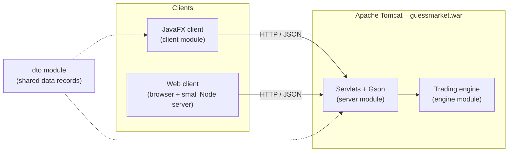

# Guess Market – Prediction Market Trading System

Guess Market is a client-server prediction market (in the spirit of Polymarket): users trade shares on the outcome of events, and the share prices reflect what the crowd believes will happen.

The system includes:

- **A trading engine** with two market mechanisms:
  - **LMSR** (Logarithmic Market Scoring Rule): an automated market maker, so you can always buy, even when nobody is selling.
  - **Order Book**: buy/sell orders matched by price and time, including **minting** of new share pairs.
- **A server** (Java Servlets on Apache Tomcat) that runs the engine and exposes it as an HTTP/JSON API.
- **A desktop client** (JavaFX).
- **A web client** (HTML/CSS/JavaScript), which works against the same server, side by side with the desktop clients.

Many users can be connected at the same time. Every client refreshes automatically, so a trade made by one user shows up for everyone within half a second.

---

## 🚀 Quick Start (no IDE needed)

**Requirements:** Windows 10/11 and **Java 25**. **Node.js** is needed only for the web client. Tomcat is bundled, so there's nothing else to install.

1. Go to the **[Releases](../../releases)** page and download the latest `GuessMarket-v3.0.zip`.
2. Extract it to any folder.
3. Double-click **`start-server.bat`** and keep that window open. The server is ready when it prints `Server startup in [...] milliseconds`.
4. Double-click **`start-client.bat`** to open the desktop app. Run it again for every extra user you want to play with.
5. *(Optional)* Double-click **`start-web-client.bat`** and the browser opens at `http://localhost:3000`.

## 🎮 How to Use

1. **Log in** with any unique user name. There are no passwords.
2. **Account tab → Load File** → choose an XML from the `samples` folder. Its events are added to the system and **you become their market maker**. Files accumulate; each upload adds more events.
3. **Load Funds:** every user starts with a balance of 0.
4. **Activate an event** (market maker only). Select it in *Events Participation \ Owner* and click **Activate Event**:
   - LMSR events: the market maker pays the initial subsidy.
   - Order Book events: the market maker buys the initial share pairs.
5. **Trade** from another user:
   - **LMSR:** choose an option and an amount of shares → **Buy**.
   - **Order Book:** Buy/Sell, option, shares and price per share → **Submit Order**. Orders that don't match wait in the book.
6. **Close the event** (market maker): choose the winning option → **Close Event**. Winners are paid, commissions go to the market maker, and every user sees their profit/loss.

### Screens

- **Events:** all events with filters (method / status / commission type). Selecting an event shows its full state:
  - LMSR: the current price of every option and the trade history.
  - Order Book: each option's order book, side by side, with **LAST / BID / ASK / MID / SPREAD**.
  - The participants and their holdings.
- **Account:**
  - The other users (balance, market maker or not, online or not).
  - Every transaction in your account, plus Load Funds.
  - Your events and your role in each.
  - The selected event's details and trading panel.
- **Chat:** a chat shared by all logged-in users (desktop client).

---

## 🏗️ Architecture

| Module | Responsibility |
|---|---|
| `dto` | Flat, logic-free records shared by the server and the clients, serialized to JSON with Gson. |
| `engine` | The passive trading engine: users, accounts and transactions, XML loading (JAXB + XSD), LMSR pricing, order matching and minting, commissions, and event closing. It has no knowledge of the UI or the server. |
| `server` | One servlet per endpoint. Engine access is synchronized at the servlet level, and the server validates all input itself. Uploaded XML is parsed in memory and never written to disk. |
| `client` | The JavaFX app. HTTP calls from the UI thread are asynchronous. A background thread polls `/version` every 0.5 seconds and fetches data only when something changed, so tables update without flicker and keep your selection. |
| `web-client` | A browser version of the client, with no framework and nothing to `npm install`. A tiny Node server serves the page and forwards API calls to Tomcat. |

### HTTP API

All endpoints are under `http://localhost:8080/guessmarket`. Responses are JSON, and errors come back as `{"message": "..."}` with HTTP 400 (or 401 when not logged in).

| Method | Endpoint | Parameters |
|---|---|---|
| POST | `/login` | `username` |
| POST | `/logout` | |
| GET | `/version` | |
| GET | `/events` | |
| GET | `/event-details` | `event` |
| GET | `/users` | |
| GET | `/user-details` | |
| GET | `/user-event-details` | `event` |
| POST | `/upload-file` | multipart part `file` |
| POST | `/deposit` | `amount` |
| POST | `/activate-event` | `event` |
| POST | `/close-event` | `event`, `winner` |
| POST | `/buy-shares` | `event`, `option`, `shares` (LMSR) |
| POST | `/place-order` | `event`, `option`, `side` (buy/sell), `shares`, `price` (Order Book) |
| GET / POST | `/chat` | `from` / `message` |

---

## 🛠️ Building from Source

Requirements: JDK 25 and Windows. The JavaFX SDK (`javafx-sdk-25.0.4`) and the libraries in `libs-part3` are expected inside the project folder, and the JAXB jars in `../Submission 1/lib`.

- **Command line:** run `build-part3.bat`. It compiles every module and produces `guessmarket.war` and the client folder.
- **IntelliJ IDEA:** open the project folder. The modules are `dto`, `engine`, `server` and `client`.

To deploy, copy `guessmarket.war` into `tomcat/webapps` and start Tomcat 10.1.

## 📄 XML Format

Events are described in XML files validated against `GM-EX3-Schema.xsd`:

- Each event has a name, a description, a commission, two options, and a trading method.
- The commission is 0–90%, charged either `on-purchase` or `on-close`.
- The method is either LMSR (with liquidity `b`) or Order Book (with base value `d`, an initial investment, and minting on/off).

The release's `samples` folder has ready-to-use files.

---

*Developed by Ben Jaitin as the main project of the Java course (Academic College of Tel Aviv-Yaffo).*
